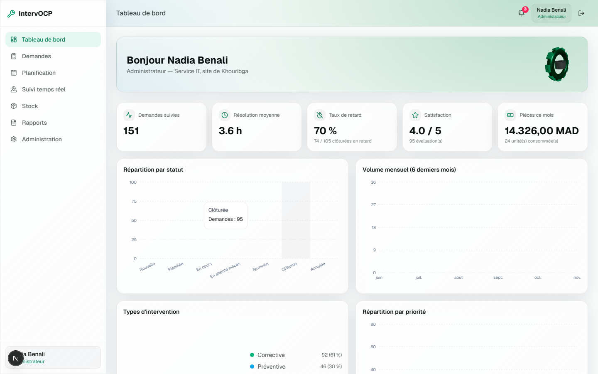

# IntervOCP — Gestion des interventions (OCP Khouribga)

Application web complète de gestion des interventions techniques du service IT
du site OCP de Khouribga : demandes, planification intelligente, suivi temps
réel, stock de pièces, rapports et exports.

> Projet de stage — stack **Next.js 15 · TypeScript · Prisma · PostgreSQL ·
> Tailwind 4 · three.js**. Thème « liquid glass » light, UI intégralement en
> français.



## Démarrage rapide

```bash
npm install

# 1. Base de données (Docker)
npm run db:up          # postgres:16-alpine sur localhost:5432

# 2. Schéma + données de démonstration
npm run db:migrate     # prisma migrate dev
npm run db:seed        # comptes, parc, demandes, pièces, pings GPS

# 3. Application
npm run dev            # http://localhost:3000
```

> npm 12 bloque les scripts d'installation par défaut : `npm install` avec
> `EALLOWSCRIPTS` configuré dans `package.json` (`allowScripts`).

## Comptes de démonstration (mot de passe : `Demo1234!`)

| Rôle | Email |
|---|---|
| Administrateur | `admin@intervocp.demo` |
| Répartiteur | `dispatcher1@intervocp.demo` |
| Technicien | `tech1@intervocp.demo` |
| Client | `client1@intervocp.demo` |
| Responsable | `manager@intervocp.demo` |

La page de connexion affiche aussi les comptes et le fond « shader gradient ».

## Fonctionnalités

- **Demandes** : création (référence `INT-AAAA-NNNN`), filtres, fiche détail
  complète (historique, commentaires, pièces jointes, incidents, pièces
  consommées, évaluation), machine à états contrôlée côté serveur.
- **Planification** : grille hebdomadaire, **suggestion de techniciens scorée**
  (compétence 40 % · disponibilité 25 % · charge 20 % · distance GPS 15 %)
  avec raisons lisibles, affectation anti double-réservation.
- **Suivi temps réel** : carte Leaflet des techniciens (SSE), partage de
  position GPS, simulateur de déplacements, kanban de statuts en glisser-déposer.
- **Stock** : catalogue, recherche, alertes de seuil, réapprovisionnement,
  consommation par intervention (décourement + journal atomiques).
- **Rapports** : KPIs par rôle, 4 graphiques, export CSV (BOM), rapport PDF
  par intervention.
- **Administration** : comptes internes, parc, référentiels.
- **Notifications** in-app avec badge et diffusion ciblée par rôle.

## Scripts

| Commande | Description |
|---|---|
| `npm run dev` | Serveur de développement |
| `npm run build` / `npm start` | Build + production |
| `npm run lint` / `npm run type-check` | Qualité statique |
| `npm test` | Tests unitaires Vitest (40) |
| `npm run e2e` | Tests E2E Playwright (22) |
| `npm run db:up` / `db:down` | PostgreSQL Docker up/down |
| `npm run db:migrate` / `db:seed` | Schéma / données de démo |
| `npx tsx docs/scripts/screenshots.ts` | Captures d'écran par rôle |

## Documentation

| Document | Contenu |
|---|---|
| [`docs/requirements.md`](docs/requirements.md) | Analyse des besoins, exigences RF/RNF, traçabilité |
| [`docs/architecture.md`](docs/architecture.md) | Architecture technique et choix |
| [`docs/api.md`](docs/api.md) | Référence API (endpoints, rôles, erreurs) |
| [`docs/database.md`](docs/database.md) | Modèle de données (ERD Prisma) |
| [`docs/test-report.md`](docs/test-report.md) | Résultats des tests |
| [`docs/uml/`](docs/uml/) | Diagrammes UML (PNG générés, sources PlantUML) |
| [`docs/screenshots/`](docs/screenshots/) | Captures d'écran par rôle |

## Structure du projet

```
src/
├── app/(app)/          # pages authentifiées : dashboard, requests,
│                       # planning, tracking, stock, reports, admin
├── app/api/            # ~24 route handlers REST + SSE
├── app/login/          # page publique + Server Action
├── components/         # UI client (glass design system)
├── lib/                # auth, prisma, events (SSE), format, geo…
├── server/services/    # logique métier (requests, planning, stock,
│                       # tracking, reports) + scoring pur
└── validation/         # schémas Zod
```

## Notes techniques

- **Temps réel** : bus d'événements en mémoire + SSE (`/api/stream`) — les
  clients se rafraîchissent automatiquement sur `intervention.*`,
  `location.ping`, `stock.low`, `notification`.
- **Sécurité** : bcrypt + JWT httpOnly (Auth.js v5), contrôle du rôle dans
  chaque endpoint, validations Zod, messages d'erreur en français.
- **three.js** : polyfill `cube_uv_reflection_fragment` fourni dans
  `src/lib/three-polyfills.ts` (compatibilité @shadergradient/react × three r187).
