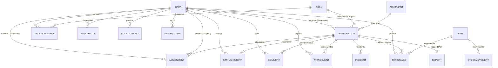

# Base de données — IntervOCP

PostgreSQL 16 (Docker), piloté par **Prisma ORM** (`prisma/schema.prisma`).
Client généré typé de bout en bout, migrations versionnées dans `prisma/migrations/`.

## Démarrage

```bash
npm run db:up        # docker compose up -d db
npm run db:migrate   # prisma migrate dev
npm run db:seed      # jeu de données de démonstration
```

## Diagramme entité-relation



## Modèles

| Modèle | Rôle | Champs clés |
|---|---|---|
| `User` | Tout acteur (5 rôles) | `name`, `email` unique, `passwordHash` (bcrypt), `role`, `active` |
| `Skill` | Compétence technique | `name` unique |
| `TechnicianSkill` | Maîtrise d'un technicien 1..5 | unique `(technicianId, skillId)`, `level` |
| `Availability` | Fenêtres WORK / LEAVE / BUSY | `technicianId`, `start`, `end`, `type` |
| `Equipment` | Parc matériel OCP | `name`, `category`, `location`, `criticality`, `status` |
| `Intervention` | Cœur du système | `reference` unique `INT-YYYY-NNNN`, `title`, `type`, `priority`, `status`, `plannedStart/End`, `actualStart/End`, `closedAt`, `satisfactionRating/Comment`, `latitude/longitude` |
| `Assignment` | Affectation technicien | unique `(interventionId, technicianId)`, `assignedBy`, `assignedAt` |
| `StatusHistory` | Journal des changements de statut | `from`, `to`, `comment`, `changedBy`, `changedAt` |
| `Comment` | Fil de discussion par intervention | `authorId`, `message`, `createdAt` |
| `Attachment` | Photos / PDF joints | `fileName`, `kind` (PHOTO/DOCUMENT), `uploadedBy`, `filePath` |
| `Incident` | Blocage signalé par le technicien | `severity` (LOW/MEDIUM/HIGH), `description`, `reportedAt` |
| `Part` | Catalogue de pièces | `reference` unique, `quantity`, `minThreshold`, `unitCost`, `location` |
| `PartUsage` | Consommation par intervention | `interventionId`, `partId`, `quantity`, `usedBy`, `usedAt` |
| `StockMovement` | Journal des entrées/sorties | `partId`, `delta` (±), `reason` (RESTOCK/USAGE/ADJUSTMENT), `createdAt` |
| `LocationPing` | Positions GPS horodatées (scoring de proximité) | `technicianId`, `latitude`, `longitude`, `timestamp` |
| `Notification` | Messages in-app | `userId`, `message`, `read`, `createdAt` |
| `Report` | Métadonnée du rapport PDF | `interventionId`, `generatedAt`, `filePath` |

## Énumérations

- **Role** : `ADMIN`, `DISPATCHER`, `TECHNICIAN`, `CLIENT`, `MANAGER`
- **Status** : `NOUVELLE`, `PLANIFIEE`, `EN_COURS`, `EN_ATTENTE_PIECES`, `TERMINEE`, `CLOTUREE`, `ANNULEE`
- **Priority** : `LOW`, `MEDIUM`, `HIGH`, `CRITICAL`
- **InterventionType** : `CORRECTIVE`, `PREVENTIVE`, `URGENT`
- **AvailabilityType** : `WORK`, `LEAVE`, `BUSY`
- **Severity** : `LOW`, `MEDIUM`, `HIGH`
- **StockMovementReason** : `RESTOCK`, `USAGE`, `ADJUSTMENT`

## Règles d'intégrité notables

1. `Intervention.reference` — générée dans une transaction (`nextReference`) :
   compteur annuel `INT-<année>-<0001>` protégé contre les courses.
2. `Assignment` — unique par couple (intervention, technicien) ; le service
   métier vérifie en plus le **chevauchement de créneaux** (anti double-réservation).
3. `PartUsage` — décrémente `Part.quantity` **dans la même transaction** qu'un
   `StockMovement` (inventaire toujours cohérent) et refuse la consommation
   au-delà du stock disponible (HTTP 409).
4. Suppressions en cascade : commentaires, pièces jointes, incidents, pings…
   liés à leur intervention.
5. Mots de passe : hash bcrypt (`bcryptjs`), jamais stockés en clair ;
   sessions via JWT Auth.js (cookie httpOnly).
